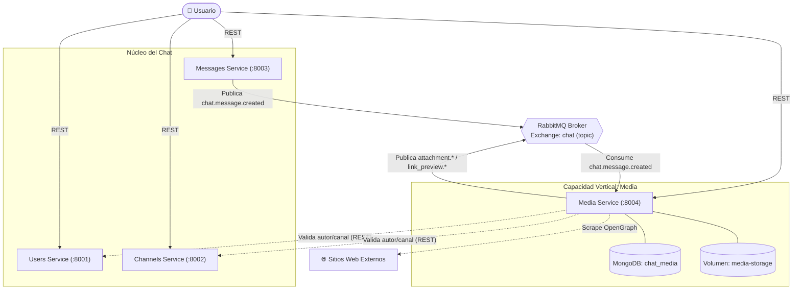
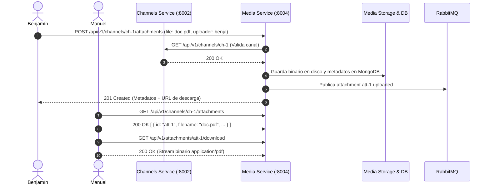
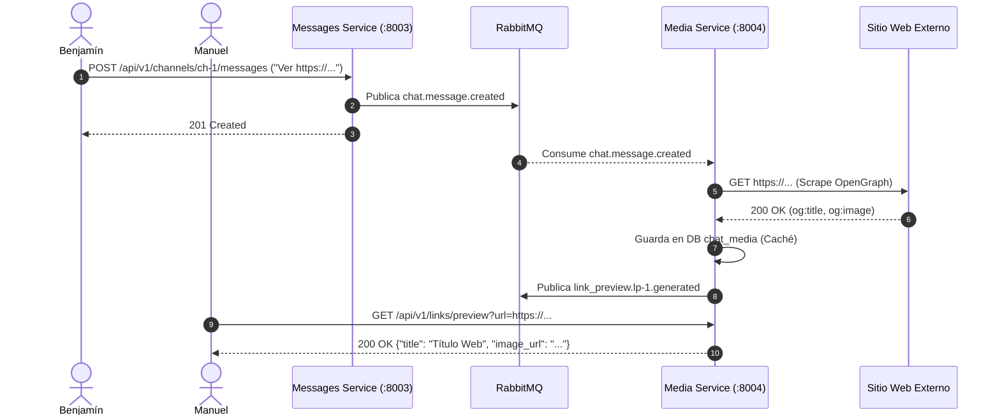

<!-- _class: invert lead -->
# 📂 Capacidad Vertical: Media Service
### Gestor de Archivos Adjuntos y Vista Previa de Medios
**Cátedra de Microservicios — Unidad 3**

---

## 📌 1. Problema de Usuario y Contexto

### 🌐 Contexto
* Los canales de chat modernos (*Slack, Discord, Teams*) son **centros de trabajo colaborativo multimedia**.
* Los equipos necesitan compartir especificaciones en PDF, capturas de pantalla de errores y enlaces web externos.

### ⚠️ Limitaciones del Chat Base
* **Solo texto plano:** El servicio `messages` admite solo strings (máx. 4.000 chars).
* **Sin soporte de binarios:** Imposible adjuntar imágenes o documentos.
* **URLs a ciegas:** Enlaces crudos sin título, imagen ni descripción.
* **Sin repositorio de canal:** No hay galería para buscar archivos compartidos.

---

## 💡 2. Propuesta de Valor y Solución

El microservicio **`media`** extiende el ecosistema del chat de forma desacoplada:

1. **Gestión de Archivos Adjuntos:** Subida (`multipart/form-data`), almacenamiento binario y descarga segura por canal.
2. **Generación Asíncrona de Link Previews:** Detección de URLs en mensajes y scraping en segundo plano de metadatos OpenGraph (*Rich Cards*).
3. **Galería de Medios por Canal:** Filtrado de archivos compartidos por categoría (`IMAGE`, `DOCUMENT`, `ARCHIVE`, etc.).
4. **Control de Cuotas de Almacenamiento:** Gestión de espacio en disco por canal sin saturar el sistema.

---

## 📖 3. Lenguaje Ubicuo (Glosario DDD)

| Concepto | Definición en el Dominio |
| :--- | :--- |
| **Archivo Adjunto (*Attachment*)** | Recurso digital (imagen, PDF) subido por un usuario y asociado a un canal. |
| **Metadatos (*Metadata*)** | Información descriptiva: nombre, tipo MIME, tamaño, hash SHA-256 y URL de descarga. |
| **Vista Previa de Enlace (*Link Preview*)** | Tarjeta resumen (título, descripción, miniatura) extraída de una URL compartida. |
| **Almacenamiento (*Media Storage*)** | Volumen físico (`/media-storage`) donde residen los archivos binarios. |
| **Cuota de Canal (*Channel Quota*)** | Límite máximo de almacenamiento acumulado asignado a un canal. |
| **Categoría de Medio (*Media Category*)** | Clasificación: `IMAGE`, `DOCUMENT`, `VIDEO`, `AUDIO`, `ARCHIVE`, `OTHER`. |

---

## 🛡️ 4. Frontera de Responsabilidad (Bounded Context)

### 📦 Dentro de la frontera de `media`
* Almacenamiento binario y metadatos de archivos.
* Scraping y caché de tarjetas OpenGraph de URLs.
* Control de cuotas de disco y validación de tipos MIME.
* Base de datos exclusiva: **`chat_media`** y volumen **`media-data`**.

### 🤝 Fuera de la frontera (Delegado al Núcleo)
* **Identidad y autenticidad:** Delegado a `users`.
* **Salas y membresía:** Delegado a `channels`.
* **Secuencia de mensajes de texto:** Delegado a `messages`.
* **Regla estricta:** Cero acceso directo a BDs ajenas; interacción solo vía REST y RabbitMQ.

---

## 🏗️ 5. Diagrama de Arquitectura de Microservicios

---

## 📡 6. Contratos de Comunicación: APIs REST (Puerto 8004)

| Método | Ruta | Código HTTP | Descripción |
| :--- | :--- | :---: | :--- |
| `POST` | `/api/v1/channels/{channel_id}/attachments` | `201 Created` | Sube archivo adjunto (`multipart/form-data`). |
| `GET` | `/api/v1/channels/{channel_id}/attachments` | `200 OK` | Galería de archivos del canal (con filtros). |
| `GET` | `/api/v1/attachments/{attachment_id}` | `200 OK` | Consulta metadatos de un archivo específico. |
| `GET` | `/api/v1/attachments/{attachment_id}/download` | `200 OK` | Descarga stream binario del archivo. |
| `DELETE`| `/api/v1/attachments/{attachment_id}` | `204 No Content`| Elimina archivo y libera cuota del canal. |
| `GET` | `/api/v1/channels/{channel_id}/quota` | `200 OK` | Consulta cuota de almacenamiento del canal. |
| `GET` | `/api/v1/links/preview?url=...` | `200 OK` | Consulta tarjeta OpenGraph en caché. |

---

## 📬 7. Contratos de Comunicación: Eventos Asíncronos

### Broker: RabbitMQ | Exchange: `chat` (*topic*)

#### 📥 Eventos Consumidos
* `chat.message.created`:
  * Inspecciona el texto mediante Regex en busca de URLs.
  * Dispara un proceso en segundo plano para raspar los metadatos OpenGraph del sitio externo.

#### 📤 Eventos Publicados (Convención: `entidad.id.acción`)
* `attachment.{id}.uploaded`: Notifica subida exitosa de un archivo.
* `attachment.{id}.deleted`: Notifica eliminación de un archivo.
* `link_preview.{id}.generated`: Notifica que la tarjeta de previsualización está lista en caché.

---

## ⚖️ 8. Justificación de Patrones de Comunicación

### 🛑 Sincrónico Request-Response (REST)
* **Dónde:** Subida (`POST`), descarga (`GET`) y validación de `users`/`channels`.
* **Justificación:** El usuario requiere confirmación inmediata del archivo cargado y transferencia directa de streams binarios de alta velocidad.

### 📨 Asincrónico Event-Driven (RabbitMQ)
* **Dónde:** Detección de URLs y generación de vistas previas (*Link Previews*).
* **Justificación:** El scraping web externo tiene **latencia impredecible** (sitios caídos/lentos). Al hacerlo por eventos, el envío de chat **nunca se bloquea**.

---

## 🔄 9. Flujo Punta a Punta 1: Subida y Descarga de Archivos

---

## 🌐 10. Flujo Punta a Punta 2: Link Previews Asíncronos

---

<!-- _class: invert lead -->
# 🎯 Conclusión
* **Aporte de Valor:** Transforma el chat base en una plataforma multimedia rica.
* **Autonomía y Escalabilidad:** Microservicio `media` con almacenamiento y base de datos propios.
* **Desacoplamiento Total:** Comunicación asíncrona no bloqueante frente a dependencias lentas.
